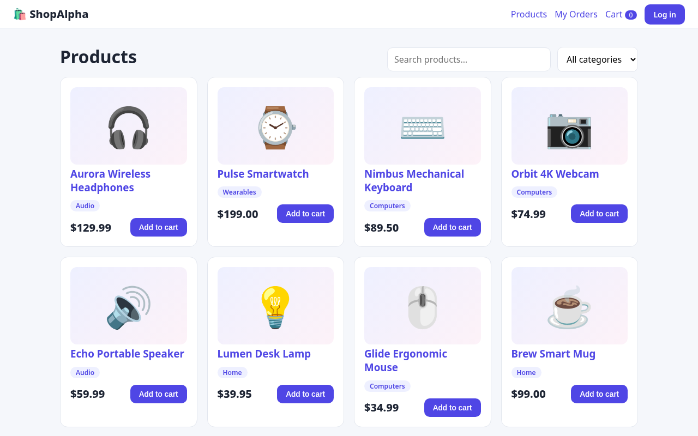
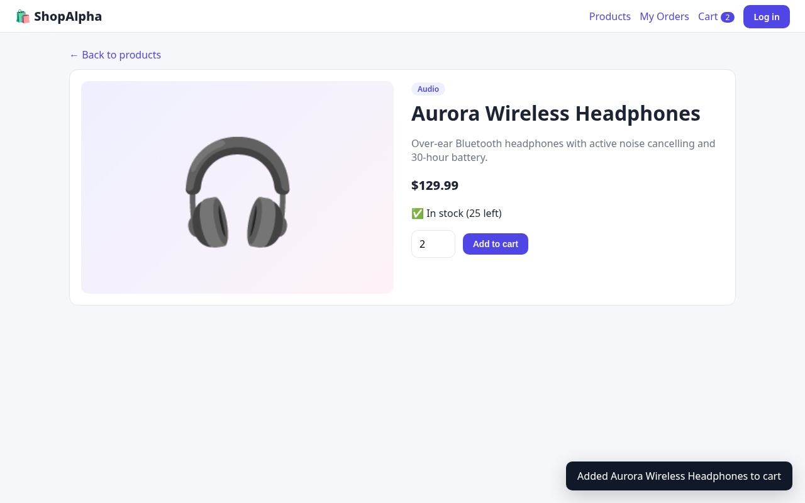
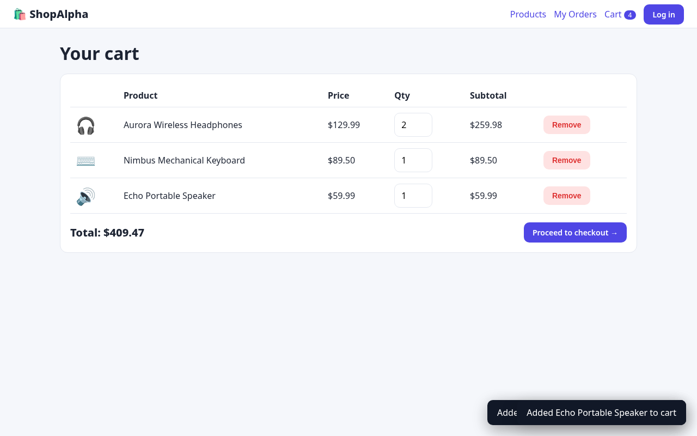
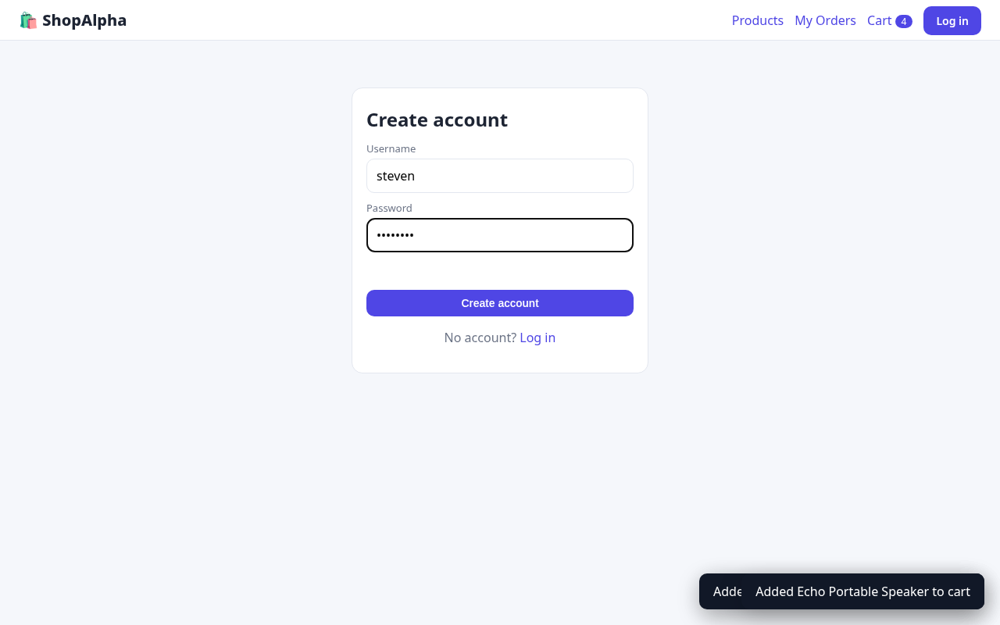
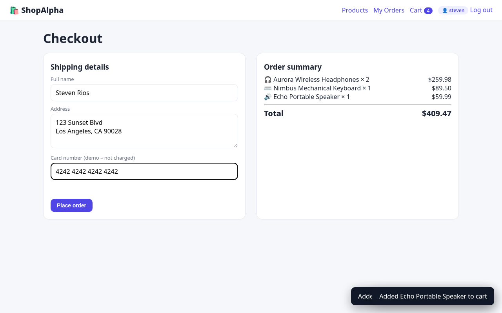
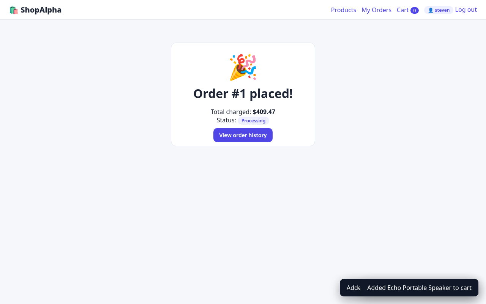

# ShopAlpha — E-commerce Store

CodeAlpha Full Stack Development Internship — **Task 1: Simple E-commerce Store**


## Features

- Product listing with search and category filters
- Product details page with stock information
- Shopping cart (persisted in the browser) with quantity controls
- User registration & login (bcrypt-hashed passwords, JWT sessions)
- Checkout & order processing — the server re-prices every item from the database and decrements stock inside a SQLite transaction (clients cannot tamper with prices)
- Order history for each user
- Input validation and friendly error messages

## Tech stack

- **Backend:** Node.js 20+, Express 5, SQLite (better-sqlite3)
- **Auth:** bcrypt password hashing (bcryptjs) + JSON Web Tokens
- **Frontend:** vanilla HTML, CSS and JavaScript (single-page app, no framework)
- **Tests:** Node's built-in test runner + Supertest — 10 tests, run on GitHub Actions (Node 20 & 22)

## Getting started

```bash
git clone https://github.com/x3r01432/CodeAlpha_EcommerceStore.git
cd CodeAlpha_EcommerceStore
npm install
npm start
```

Open <http://localhost:3000>. The SQLite database (`store.db`) is created automatically on first run and seeded with sample products.

Configuration (optional environment variables): `PORT` (default 3000), `JWT_SECRET` (set this in production — otherwise a random secret is generated on each start), `DB_FILE`.

```bash
npm test
```

## API overview

- `POST /api/auth/register`, `POST /api/auth/login`
- `GET /api/products?q=&category=`, `GET /api/products/:id`, `GET /api/categories`
- `POST /api/orders` (auth), `GET /api/orders` (auth)

## Screenshots

**Products**



**Product detail**



**Cart**



**Register**



**Checkout**



**Order placed**


**Order history**



## Author

**Steven Manuel Rios** ([@x3r01432](https://github.com/x3r01432)) — built for the CodeAlpha Full Stack Development internship.

## License

[MIT](LICENSE) © 2026 Steven Rios
